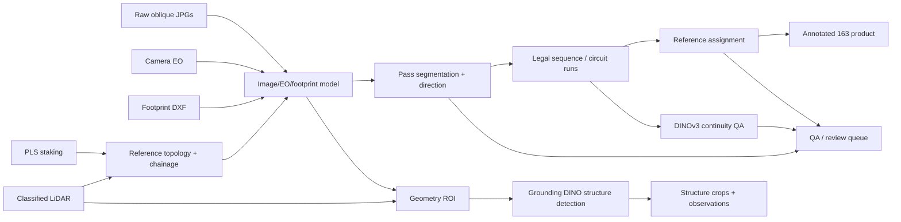

# Architecture

## Pipeline stages

### A. Reference geometry

- discover latest versioned input folders;
- parse PLS-CADD staking XML;
- determine working CRS;
- build physical PLS topology;
- derive canonical reference structures/spans;
- create circuit alignment and chainage;
- optionally profile LiDAR classes and structure heights.

### B. Image/EO/footprint model

- index raw imagery;
- parse EO records (`Image, X, Y, Z, O, P, K` variants);
- join DXF footprint polygons to source imagery;
- compute camera chainage and corridor distance;
- derive approximate OPK optical target when usable;
- keep geometry and optical reference candidates separately.

### C. Pass model

Pass segmentation is performed within each EO source. Current direction classification uses camera
motion projected onto the circuit alignment. `CROSSING_PASS` is used when along-circuit progression
is too small relative to flight motion.

This classifier is a known calibration area: the manual benchmark identified legitimate frames that
were classified as crossing/unknown on DH1.

### D. Sequence model

- build legal product images;
- stitch compatible pass fragments into circuit runs;
- calculate ordered sequence index per run and direction;
- calculate pass-specific coverage/gaps;
- preserve partial-span frames.

### E. Reference resolver

Reference assignment retains evidence such as:

- `primary_span_geometry`;
- `primary_span_optical`;
- `primary_span_method`;
- `reference_chainage`;
- `reference_assignment_status`;
- `reference_confidence`;
- `alternative_reference` near boundaries.

Backward-pass off-by-one errors observed in benchmarking show that this layer needs a direction-aware
resolver before production use.

### F. Visual continuity QA

DINOv3 features are extracted from adjacent logical product frames. Current metrics include global
similarity, dense patch similarity, reciprocal/mutual matches and spatial coherence. Geometry and
visual evidence are combined into review statuses without changing membership.

### G. Structure detection/crops

Current v0.14 flow:

1. LiDAR/EO/footprint geometry predicts a source-pixel prior.
2. Build a local ROI around the prior.
3. Tile only the local ROI at source resolution.
4. Run Grounding DINO tower detection.
5. Filter boxes by full-image and ROI plausibility.
6. Apply a geometry association gate.
7. Score candidates using detection confidence + geometry distance (+ optional DINO tracking).
8. Assign detections one-to-one where multiple structures share an image.
9. Render crop only after an accepted visual detection.

No acceptable detection = no crop. The continuous frame remains untouched.

### H. Packaging

The delivery packager separates:

- annotated continuous 163 imagery;
- clean structure crops for ML/FLI use;
- tagged structure crops for human review;
- per-structure observations;
- global structure coverage;
- selected QA metadata.

## High-level flow

