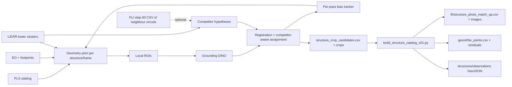

# Structure catalogue

Long-term goal: a catalogue of transmission structures cut from continuous-oblique source frames,
each observation tagged with its source data (structure id, type, location, source frame, camera EO,
pass/view direction, pixel geometry, detector evidence). The catalogue is used for:

1. **FLI structure photos** – [FLI_frame_maker](https://github.com/sevcieslik/FLI_frame_maker) frames
   catalogue crops directly instead of a manual structure/photo match.
2. **Georeference validation** – every accepted detection is an image↔world tie point, which can be
   used to measure the EO/OPK error of this project and to validate another georeferencing process.



Georeference narrows the search (only frames whose footprint covers the structure, only a local ROI
around the projected tower); the detector supplies the visual evidence; the catalogue records both,
so the detections can later check another georeferencing process.

## Running

```powershell
# 1. pipeline (v0.15). Keep crops at full resolution when they feed FLI framing.
python src\continuous_oblique_v015.py "D:\Sev\Obliques\DH1" --circuit DH1 --structure-class 215 `
    --render-mode full --render-other-views --crop-max-dimension 0 `
    --competitor-structures "D:\...\00_structures_by_circuit\DH2_structures.csv" `
    --output "D:\Sev\Obliques\DH1\_continuous_oblique_DH1_full_v015"

# 2. catalogue
python src\build_structure_catalog_v01.py "D:\Sev\Obliques\DH1\_continuous_oblique_DH1_full_v015" --circuit DH1

# 3. FLI framing (FLI_frame_maker/current)
python 03_frame_generator_v4.py --batch --preset presets\NYPA_Settings_Layout.json `
    --csv  <catalog>\fli\structure_photo_match_qa.csv --images <catalog>\fli\images `
    --output <catalog>\fli\framed --nm-logo nmgroup-logo.png --client-logo nypa-logo.jpg
```

`runners/RUN_full_circuit_v015.ps1` runs pipeline → packager → catalogue → evaluation pack.

## Catalogue contents

| File | Content |
|---|---|
| `crops/<ref>_<structure>/…jpg` | clean detector crops, never annotated |
| `structure_catalog_observations.csv` | one row per observation (schema below) |
| `structure_catalog_structures.csv` | one row per reference structure: location, counts, best views, `catalog_status` (`CATALOGUED`, `NO_ACCEPTED_DETECTION`, `NOT_ATTEMPTED`) and attempt status counts |
| `structures.geojson`, `observations.geojson` | WGS84 points and camera→structure rays |
| `georef/tie_points.csv` | detected tower base (u,v) ↔ staking X,Y + LiDAR ground Z |
| `georef/residuals_by_image.csv`, `residuals_by_pass.csv` | detection − projection residuals, `EO_BIAS_SUSPECT` |
| `fli/structure_photo_match_qa.csv` | FLI assignment CSV, best view per structure |
| `fli/structure_photo_match_all_views.csv` | every observation in FLI schema |
| `fli/images/` | crops with the raw frame EXIF (capture time, camera, GPS) inserted losslessly |

Key observation fields: `catalog_obs_id`, `structure_id` (= PLS `structure_number`, the key FLI uses to
look up the staking XML), `reference_idx`, `structure_type`, `structure_x/y`, `structure_lat/lon`, `epsg`,
`source_image`, `pass_id`, `pass_direction`, `view_direction`, `crop_bucket`, `camera_x/y/z`,
`omega/phi/kappa`, `camera_distance_m`, `bearing_camera_to_structure_deg`, `tower_box_*`, `crop_*`,
`detected_base_u/v_px`, `tower_detector_score`, `tower_ownership`, `catalog_confidence`,
`quality_grade`, `residual_consistency`, `is_best_view`, `best_view_rank_*`, `catalog_crop_sha1`.

### Grades

| Grade | Meaning |
|---|---|
| A | v0.15 `HIGH` confidence: target owns the detection, clear score margin, registration accepted or not needed |
| B | `HIGH`/`MEDIUM` with weaker evidence |
| C | pre-v0.15 run (`UNGRADED`) or per-pass residual `OUTLIER` |

`residual_consistency = OUTLIER` means the detection-minus-prior residual differs from the rest of the
same pass by more than `max(3·MAD, 300 px)` on an image axis. On the DH1 smoke run this flagged exactly
the one crop that showed the parallel DH2 tower. Outliers are kept and flagged, never deleted.

Best-view ranking is metadata only; all observations stay in the catalogue (product rule 6).

## FLI integration notes

- The FLI CSV follows the `CSV_FIELDS` order of `current/01-02_*_manual_structure_match_v1.py`.
  `match_method = continuous_oblique_auto_detection`, `match_status = auto_detected_<confidence>`,
  `anchor = yes` for best views. `warning` carries `confidence_medium`, `no_raw_exif`,
  `residual_outlier_review`.
- FLI takes the date/time from EXIF. Pass `--raw-dir` when the raw paths in the run CSV are not reachable
  from the machine building the catalogue, otherwise rows get `no_raw_exif`.
- FLI v4 scales images to its output width. Detector crops capped at 1600–2048 px are upscaled ~3.5×;
  run the pipeline with `--crop-max-dimension 0` for FLI use.
- Verified end-to-end: the DH1 smoke catalogue was framed by `03_frame_generator_v4.py --batch` with the
  NYPA preset (3 frames, Product QC KMZ and integration sheet written).

## Georeference validation

`tie_points.csv` pairs the detected tower base pixel with the staking position and LiDAR ground height.
For this pipeline's own camera model, `prior_residual_*` and `georef_residual_*` measure the EO/OPK +
footprint projection error per frame/pass. For another georeferencing process, project the same world
points with that process's camera model and compare against `detected_base_u/v_px` – only grade A/B,
`residual_consistency = OK` rows should be used as validation points.

## Measuring detector quality

```powershell
python tools\evaluate_structure_detector_v01.py <run_output>
# label _detector_eval\adjudication_template.csv -> adjudication.csv, then
python tools\evaluate_structure_detector_v01.py <run_output> --adjudication adjudication.csv
```

Reports crop yield, status/registration counts, residual statistics and, with labels, precision,
wrong-structure rate and recall estimate split by confidence.
